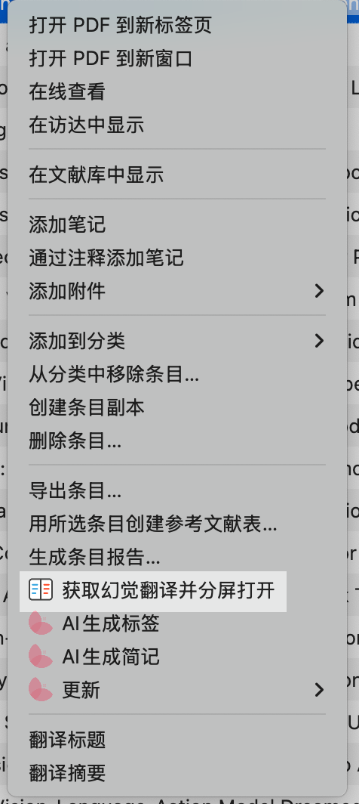
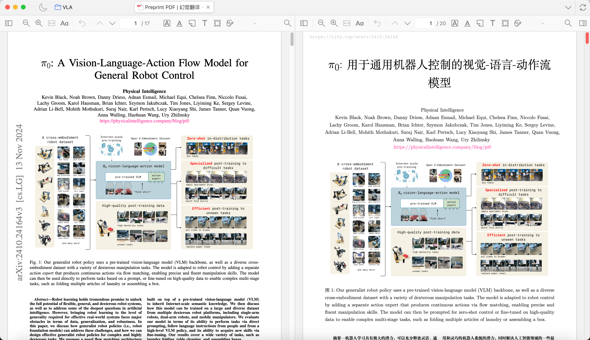

# HJFY Split Reader

[](https://www.zotero.org/)
[](https://github.com/Infinity4B/zotero-hjfy-split-reader/actions/workflows/ci.yml)
[](https://github.com/Infinity4B/zotero-hjfy-split-reader/actions/workflows/release.yml)
[](https://github.com/windingwind/zotero-plugin-template)

用于 Zotero 8 / 9 / 10 的插件：获取 arXiv 论文在 HJFY 上的译文 PDF，并把原文 PDF 与译文 PDF 以分屏方式并排打开。

[简体中文](README.md) | [English](doc/README-en.md)

## 功能

- 在条目右键菜单中增加“获取幻觉翻译并分屏打开”
- 如果同一条目下已经存在完全相同 arXiv 版本的 HJFY 译文附件，则直接复用
- 如果 HJFY 已经有可下载的译文 PDF，则自动下载并保存为当前条目的子附件
- 从本地 PDF 首页、附件信息和条目元数据中识别具体 arXiv 版本，确保原文与译文版本一致
- 同一条目有多个版本的原文 PDF 时，右键主条目会自动选择版本号最高的原文
- 本地 PDF 的版本一旦确认便不会自动切换；HJFY 返回其他版本时停止下载
- HJFY 任务排队、源码准备及 PDF 地址延迟生成时，自动等待并继续轮询
- 识别 HJFY 的预览版译文（未解锁时仅前 5 页），不会把它当作完整译文保存或复用
- 登录 HJFY 后，可在确认扣除的页数后使用账号额度解锁全文；未解锁时先以「幻觉翻译预览」附件分屏打开
- 自动将原文 PDF 和译文 PDF 以单标签页分屏方式打开
- 默认以右侧译文窗格为主窗格，左侧原文跟随译文滚动
- 保留分屏阅读器的交换左右窗格等能力

## 界面预览

### 右键菜单入口

<p align="center">
  
</p>

### 分屏阅读效果

<p align="center">
  
</p>

## 当前支持范围

- 仅支持 `2401.12345v2` 这类现代 arXiv 编号，不解析旧式分类编号
- 支持最好：本地 PDF 首页包含 arXiv 版本戳，或附件/条目元数据中含完整的 `arXiv ID + vN`
- 支持：HJFY 源码准备、翻译任务排队及 PDF 地址延迟生成的情况
- 暂未自动化：HJFY 的“本地文档上传”流程，因为 `hjfy.top` 目前要求登录后才能上传和创建任务

如果 HJFY 对当前论文要求登录后才能创建翻译任务，插件会在 Zotero 内打开 HJFY 登录页。登录状态保存在 Zotero 中，登录后重新执行即可。

### 预览版与解锁全文

HJFY 目前未解锁时只提供前 5 页的预览版译文，全文需要使用账号额度解锁，扣除的页数以 HJFY 的报价为准。

- 未登录：弹窗让你选择「查看预览版」「登录」或「取消」。查看预览版会保存并打开标注为「幻觉翻译预览」的附件；已保存过预览的论文不再询问，直接打开预览
- 也可以在插件设置的「幻觉翻译账号」中登录、查看登录状态和剩余额度，或退出登录
- 已登录：显示全文页数和当前余额，可选择「解锁全文」「查看预览版」或「取消」，只有选择解锁才会扣除额度；余额不足时只能查看预览版或取消，请自行到 HJFY 网站充值
- 获取到全文后，同一版本的预览附件会被移到 Zotero 回收站
- 旧版插件保存的预览版（附件只有 5 页而原文更长）会被识别为预览，不再当作完整译文复用

额度保护：

- 只有在确认框中点击「解锁全文」才会扣除额度；默认按钮是「查看预览版」，按回车或 Esc 都不会扣费
- 确认框显示 HJFY 报价的页数、当前余额和解锁后剩余额度；报价的版本必须与本地论文版本一致，页数必须是正整数，否则不提供解锁
- 解锁请求只发送一次，不会自动重试；如果请求发出后没有收到明确结果，插件会提示到网站核对，而不是当作失败
- HJFY 已显示解锁的版本，或插件曾经为其提交过解锁的版本，不会再次提供解锁
- 同一篇论文在处理中时，重复点击不会开启第二个流程
- HJFY 上还没有译文时，提交翻译任务也需要先确认，默认按钮是「取消」。HJFY 网页界面上提示提交任务「不预占、不扣费」，但这只是网页提示文字而非正式收费规则，插件无法保证它今后不变

为避免静默下载错误版本，本地 PDF 的完整版本会作为整个流程不可变的目标。插件会校验 HJFY 返回的译文文件编号；任何版本不一致都会停止操作，而不会自动切换到最新版。

如果插件只能识别基础 arXiv ID、同一层元数据包含多个版本，或 PDF 与父条目编号冲突，操作会停止并提示修正元数据。多个 PDF 中明确标记为补充材料、附录或幻灯的附件不会阻止主论文版本选择；其他无法确认版本的 PDF 仍需用户直接选择。

旧版插件保存的无版本译文无法验证版本，插件会先尝试获取带完整版本号的新译文。如果 HJFY 只能提供预览版或要求登录，则改为打开这份旧译文，不再弹出解锁提示。

## 安装

1. 打开 [Releases](https://github.com/Infinity4B/zotero-hjfy-split-reader/releases)
2. 下载最新的 `.xpi`
3. 在 Zotero 中打开 `工具` -> `插件`
4. 点击右上角齿轮 -> `Install Plugin From File...`
5. 选择下载的 `.xpi`

## 使用方式

1. 在 Zotero 中选中一篇论文条目，或这篇论文下的某个 PDF 附件
2. 右键点击 `获取幻觉翻译并分屏打开`
3. 插件会按下面顺序执行：
   - 先从本地 PDF 确认具体 arXiv 版本
   - 按完整版本编号检查当前条目下是否已有对应译文附件
   - 若没有，则按同一完整版本查询 `hjfy.top`
   - 校验 HJFY 返回的文件版本标识和 PDF 文件格式后，保存到当前条目附件中
   - 最后把原文 PDF 与译文 PDF 分屏打开

## 开发

```bash
npm install
npm start
```

常用命令：

```bash
npm run build
npm run lint:check
npm test
npm run test:zotero
npm run release:check
```

`npm test` 运行不依赖 Zotero 的 Node 单元测试；`npm run test:zotero` 运行 Zotero 集成测试。

构建输出位于 `.scaffold/build/`，包括：

- `.scaffold/build/hjfy-split-reader.xpi`
- `.scaffold/build/update.json`

## 发版流程

为了避免“tag 已经推上去，CI 才发现 lint/build 问题”的情况，推荐固定按下面顺序发版：

1. 完成功能修改后，先运行：

```bash
npm run release:check
```

2. 确认本地 `lint + build` 都通过后，再更新 `package.json` 与 `package-lock.json` 中的版本号。
3. 重新执行一次 `npm run build`，确认产物版本正确。
4. 提交版本改动：

```bash
git add package.json package-lock.json <other changed files>
git commit -m "Release x.y.z"
```

5. 先推送分支，再确认 GitHub Actions 的 `CI` 成功：

```bash
git push origin main
```

6. 确认 `CI` 中的 `lint`、`build`、`test` 全部通过后，最后再打 tag 并推送：

```bash
git tag vx.y.z
git push origin vx.y.z
```

说明：

- `.github/workflows/ci.yml` 会在 `main` 的 push 上运行 lint、build、test。
- `.github/workflows/release.yml` 是由 `v*` tag 触发的，所以 tag 必须放在最后一步。
- `npm test` 运行 Node 单元测试；需要 Zotero 环境的集成测试使用 `npm run test:zotero`。
- 如果只是格式问题，先运行 `npx prettier --write .` 或 `npm run lint:fix`，再重新检查。

## 第三方来源与许可

本项目包含原创代码，也包含基于以下开源项目改写和衍生的部分：

- [windingwind/zotero-plugin-template](https://github.com/windingwind/zotero-plugin-template)：提供项目结构、构建工具链和插件脚手架。许可证为 `AGPL-3.0-or-later`。
- [zerolfl/zotero-split-view-reader](https://github.com/zerolfl/zotero-split-view-reader)：提供分屏阅读器核心实现及相关 UI 资源，本项目在其基础上做了适配与修改。许可证为 `AGPL-3.0-or-later`。
- [ANGJustinl/zotero-plugin-hjfy](https://github.com/ANGJustinl/zotero-plugin-hjfy)：提供 HJFY 接口接入思路与附件导入流程，本项目在其基础上做了适配与修改。许可证为 `AGPL-3.0-or-later`。

各上游项目的版权声明与许可证条款，请同时参见 [LICENSE](LICENSE) 与对应上游仓库。

## 许可证

AGPL-3.0-or-later
