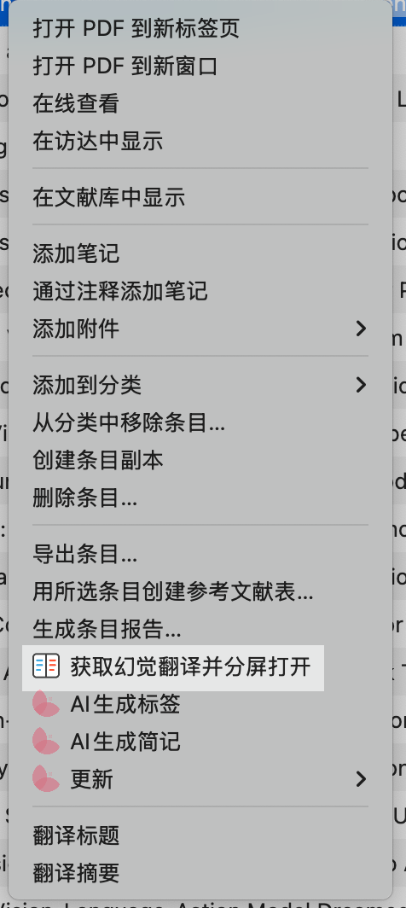
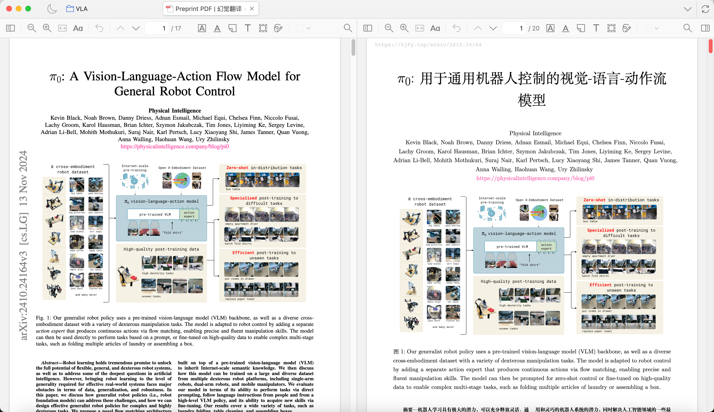

# HJFY Split Reader

**Right-click an arXiv paper in Zotero to fetch its Chinese translation from [HJFY](https://hjfy.top) and read it side by side with the source PDF in one split-view tab.**

[](https://www.zotero.org/)
[](https://github.com/Infinity4B/zotero-hjfy-split-reader/releases/latest)
[](https://github.com/Infinity4B/zotero-hjfy-split-reader/releases)
[](https://github.com/Infinity4B/zotero-hjfy-split-reader/releases/latest)
[](https://github.com/Infinity4B/zotero-hjfy-split-reader/actions/workflows/ci.yml)
[](../LICENSE)
[](https://github.com/Infinity4B/zotero-hjfy-split-reader/stargazers)
[](https://github.com/windingwind/zotero-plugin-template)

For Zotero 8 / 9 / 10. The plugin detects the exact arXiv version of your local PDF (for example `2401.12345v2`), fetches only a translation of that same version, saves it as a child attachment, and opens both in split view: the translation on the right, with the source on the left following its scrolling.

[简体中文](../README.md) | [English](README-en.md)

> [!IMPORTANT]
> **v0.2.0-rc1 pre-release is out. Please try it and send feedback.**
>
> This document describes v0.2.0-rc1. HJFY now serves only the first 5 pages until a paper is unlocked, and stable v0.1.7 cannot tell such previews apart. The pre-release adds preview detection, HJFY account login, and full-text unlock with your quota (sections marked 🧪).
>
> - Download the pre-release: [hjfy-split-reader.xpi (v0.2.0-rc1)](https://github.com/Infinity4B/zotero-hjfy-split-reader/releases/download/v0.2.0-rc1/hjfy-split-reader.xpi). Install it the same way as the stable release, over your existing installation
> - Automatic updates of the stable release do **not** deliver pre-releases, so install it manually once
> - Please report problems in [Issues](https://github.com/Infinity4B/zotero-hjfy-split-reader/issues). v0.2.0 final will follow once pre-release feedback settles

## Features

- Adds an item context-menu action: `Fetch HJFY translation and open in split view`
- Reuses an existing HJFY translation attachment only when its full arXiv version matches
- Downloads and stores the translated PDF as a child attachment when HJFY already has a translated file
- Detects the exact arXiv version from the local PDF, attachment metadata, or item metadata so the source and translation versions match
- Selects the highest detected version when a parent item contains multiple source PDFs
- Keeps the confirmed local PDF version as the immutable target and stops if HJFY returns another version
- Keeps polling while HJFY prepares sources, queues translation tasks, or delays publishing the finished PDF URL
- 🧪 Detects HJFY preview translations (only the first 5 pages until unlocked) and never saves or reuses them as full translations
- 🧪 After you log in to HJFY, unlocks the full translation with your account quota once you confirm the page cost; until then, opens a `幻觉翻译预览` (preview) attachment
- Opens the source PDF and translated PDF in a single split-view reader tab
- Makes the translated pane on the right the default primary pane, so the source pane follows its scrolling
- Keeps Split-View Reader capabilities such as pane swapping

## Screenshots

The screenshots below show the Chinese Zotero UI, which is the default presentation of this project.

### Context-menu entry

<p align="center">
  
</p>

### Split-view reader

<p align="center">
  
</p>

## Current Scope

- Supports modern arXiv IDs such as `2401.12345v2`; legacy category-style IDs are not parsed
- Supported well: papers whose local PDF contains an arXiv version stamp, or whose attachment/item metadata contains a complete `arXiv ID + vN`
- Supported: HJFY source preparation, queued translation tasks, and delayed PDF URL availability
- Not yet automated: HJFY local-document upload flow, because `hjfy.top` currently requires login for uploads and task creation

If HJFY requires login to create a translation task, the plugin opens the HJFY login page inside Zotero. The login is kept in Zotero, so run the action again after logging in.

### 🧪 Previews and full-text unlock

> This section requires the [v0.2.0-rc1 pre-release](https://github.com/Infinity4B/zotero-hjfy-split-reader/releases/tag/v0.2.0-rc1).

HJFY now serves only a 5-page preview until a paper is unlocked with account quota; the number of pages charged is whatever HJFY quotes.

- Not logged in: a dialog offers `View preview`, `Log in`, or `Cancel`. Viewing the preview saves and opens an attachment marked `幻觉翻译预览`; papers that already have a saved preview open it directly without asking
- You can also log in from the plugin preferences under `HJFY Account`, which shows the login status and remaining quota and lets you log out
- Logged in: the plugin shows the full page count and your balance and offers `Unlock full text`, `View preview`, or `Cancel`; quota is only spent when you choose to unlock. If the balance is too low, you can only view the preview or cancel; top up on the HJFY website yourself
- Once the full translation is saved, preview attachments of the same version are moved to the Zotero trash
- Previews saved by earlier releases (a 5-page attachment for a longer paper) are recognized as previews and no longer reused as full translations

Quota safeguards:

- Quota is only spent when you click `Unlock full text` in the confirmation dialog; the default button is `View preview`, so Enter or Esc never spends quota
- The dialog shows the pages HJFY quotes, your balance, and the balance after unlocking; the quote must be for exactly the local version with a positive whole page count, otherwise unlocking is not offered
- The unlock request is sent once and never retried automatically; if no clear result comes back, the plugin asks you to check on the website instead of reporting a failure
- Versions HJFY already reports as unlocked, or that the plugin has submitted an unlock for, are never offered for unlocking again
- Clicking again while the same paper is being processed does not start a second run
- When HJFY has no translation yet, submitting a translation task also needs your confirmation, with `Cancel` as the default button. The HJFY web interface currently shows a note that submitting reserves and charges nothing, but that is interface text rather than a published pricing rule, and the plugin cannot guarantee it will not change

To avoid silently downloading a different revision, the exact local PDF version remains the target throughout the operation. The plugin validates the translated-file identifier returned by HJFY, and stops instead of switching to the latest revision when it does not match.

The action also stops when only a base ID is available, one metadata layer contains conflicting versions, or the PDF conflicts with its parent item. Clearly named supplementary, appendix, or slide attachments do not block automatic source selection; other PDFs with an unknown version still require the user to select the intended attachment directly.

Legacy translation attachments without a version cannot be verified, so the plugin first tries to fetch a new translation with a full version. If HJFY only offers a preview or requires login, the plugin opens the legacy translation instead, without asking to unlock.

## Install

1. Download the `.xpi`:
   - Pre-release (recommended; supports preview detection and full-text unlock): [v0.2.0-rc1](https://github.com/Infinity4B/zotero-hjfy-split-reader/releases/download/v0.2.0-rc1/hjfy-split-reader.xpi)
   - Stable: [latest stable release](https://github.com/Infinity4B/zotero-hjfy-split-reader/releases/latest); all versions are on [Releases](https://github.com/Infinity4B/zotero-hjfy-split-reader/releases)
2. If your browser treats the `.xpi` as a Firefox extension, right-click the link and choose "Save Link As..."
3. In Zotero, open `Tools` -> `Plugins`
4. Click the gear icon -> `Install Plugin From File...`
5. Select the downloaded `.xpi`

## Usage

1. In Zotero, select one paper item or one PDF attachment under that paper
2. Right-click and choose `Fetch HJFY translation and open in split view`
3. The plugin will:
   - determine the exact arXiv version of the local PDF
   - find an existing translation attachment for that exact version
   - otherwise query the same full version on `hjfy.top`
   - verify the returned file-version identifier and PDF file format before saving it
   - open the source PDF and translation in split view

## Development

```bash
npm install
npm start
```

Useful commands:

```bash
npm run build
npm run lint:check
npm test
npm run test:zotero
```

`npm test` runs Node unit tests without Zotero. `npm run test:zotero` runs the Zotero integration tests.

Build output is written to `.scaffold/build/`, including:

- `.scaffold/build/hjfy-split-reader.xpi`
- `.scaffold/build/update.json`

## Third-Party Notices

This project includes original work and derivative work based on the following open-source projects:

- [windingwind/zotero-plugin-template](https://github.com/windingwind/zotero-plugin-template): project structure, build tooling, and plugin scaffold. Licensed under `AGPL-3.0-or-later`.
- [zerolfl/zotero-split-view-reader](https://github.com/zerolfl/zotero-split-view-reader): split-view reader implementation and related UI assets, adapted and modified for this project. Licensed under `AGPL-3.0-or-later`.
- [ANGJustinl/zotero-plugin-hjfy](https://github.com/ANGJustinl/zotero-plugin-hjfy): HJFY API integration approach and attachment import flow, adapted and modified for this project. Licensed under `AGPL-3.0-or-later`.

Please see [LICENSE](../LICENSE) and the upstream repositories for their respective copyright notices and license terms.

## License

AGPL-3.0-or-later
